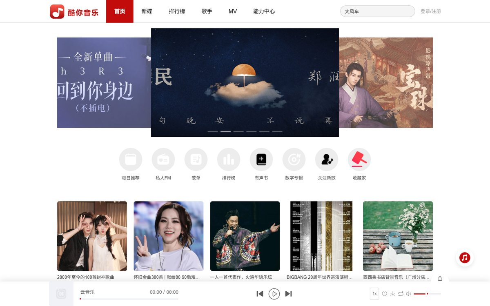
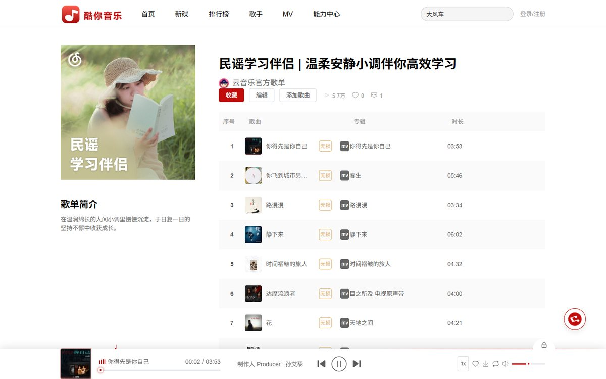
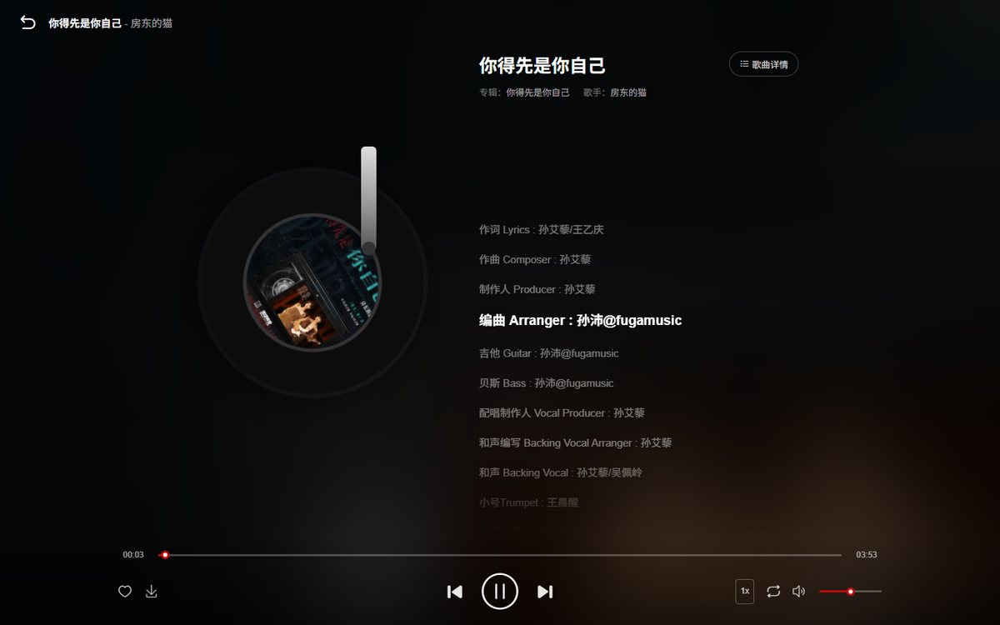
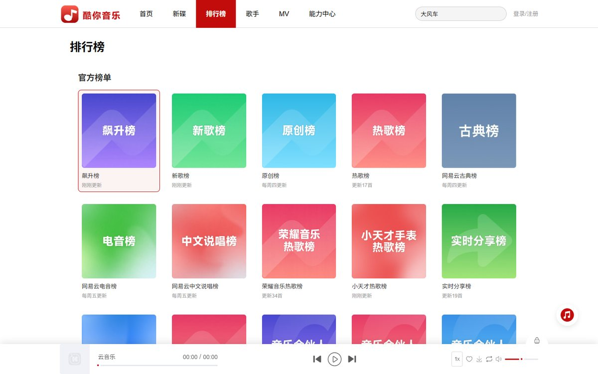
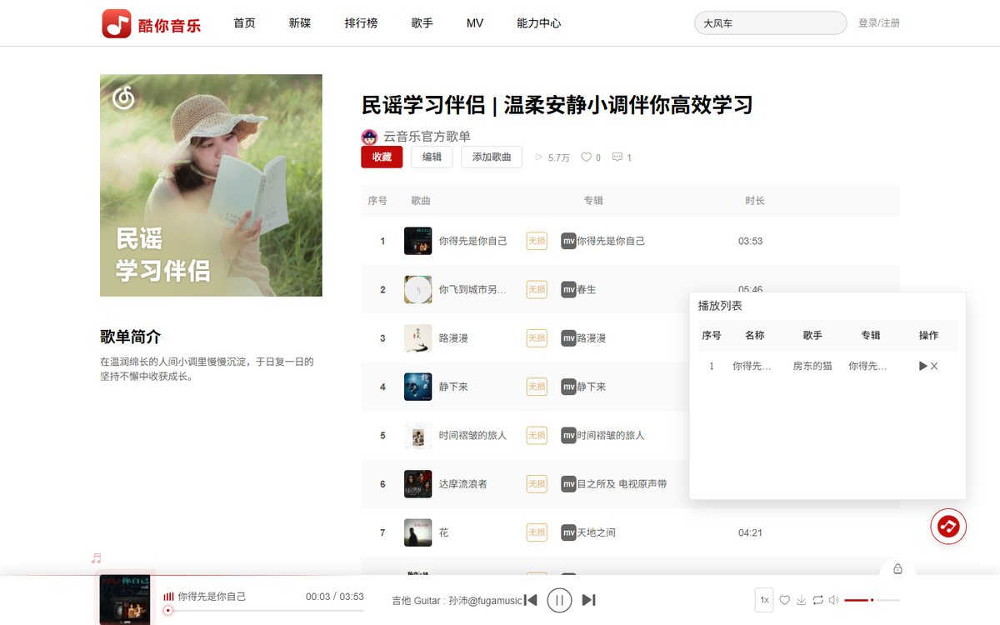
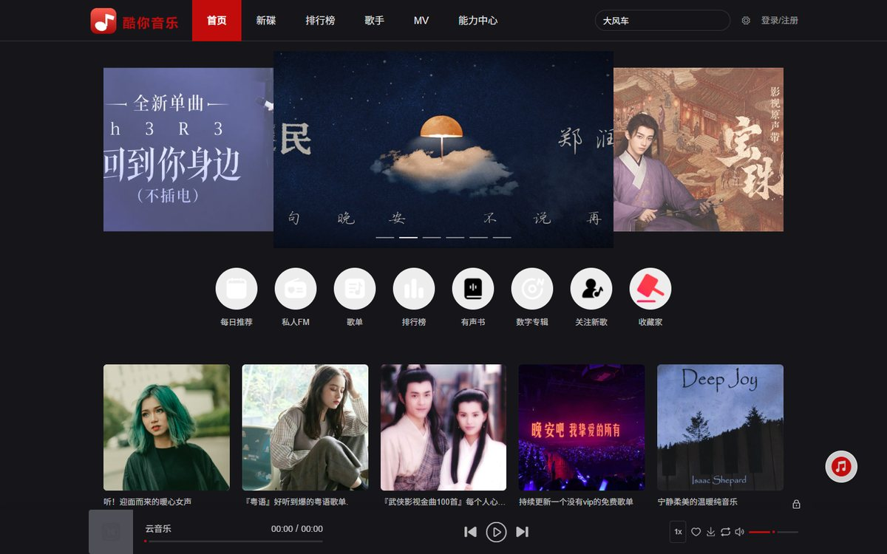

# 云音乐

仿网易云音乐的完整项目：Web 播放器前端 + 本地 API 服务端。前端是 Vue 3 + TypeScript + Vite 的单页应用，服务端基于 NeteaseCloudMusicApi，覆盖 309 个接口。

| 目录                  | 内容                               |
| --------------------- | ---------------------------------- |
| `cloud-music-web/`    | Web 前端                           |
| `cloud-music-server/` | API 服务端（NeteaseCloudMusicApi） |
| `docs/screenshots/`   | 本文档所用截图                     |
| `openspec/`           | 需求与变更记录                     |

## 界面预览

**首页**：轮播、金刚区入口、推荐歌单与榜单



**歌单详情**：播放中歌名前的音浪、封面呼吸光与音符飞散



| 歌曲详情（黑胶唱片）                          | 排行榜                               |
| --------------------------------------------- | ------------------------------------ |
|  |  |

**播放列表**：右下角悬浮入口，点击展开当前队列



## 功能

| 模块     | 能力                                                                 |
| -------- | -------------------------------------------------------------------- |
| 发现     | 首页轮播、每日推荐、歌单广场、排行榜、新碟上架、歌手列表             |
| 搜索     | 单曲 / 歌手 / 专辑 / 歌单 / MV 分类型，搜索建议与热搜榜              |
| 歌曲详情 | 黑胶唱片、逐字歌词、评论（分页 / 点赞 / 回复）、相似歌曲与歌手       |
| 播放器   | 队列、播放模式（顺序 / 单曲 / 随机）、倍速、进度记忆、音量、歌词同步 |
| 歌单     | 创建、编辑、收藏、加歌、删歌、歌单内移除                             |
| 歌曲操作 | 收藏（红心）、下载、加入播放队列、跳详情                             |
| 其他     | MV、播客、电台、云贝、动态、消息、手机号 / 邮箱 / 二维码登录         |
| 能力中心 | 接口调试台，按业务分组直接调接口看原始响应                           |

## 播放器

### 播放态动效

全部由 `isPlaying` 驱动，暂停即静止，`prefers-reduced-motion` 下自动关闭。

| 位置     | 效果                                                                 |
| -------- | -------------------------------------------------------------------- |
| 歌名前   | 4 根音浪错峰起伏                                                     |
| 封面     | 红色呼吸环 + 2% 呼吸缩放                                             |
| 封面中心 | 起播抛出 7 颗音符，播放中每 1.1s 续飘 1 颗，沿三次贝塞尔曲线         |
| 控制条   | 顶部品牌色流光横移，进度滑块柔光                                     |
| 列表点歌 | 从鼠标位置抛一个封面缩略图，沿二次贝塞尔曲线飞向播放器封面，落点脉冲 |

曲线都由 `offset-path` 驱动，JS 只生成路径字符串，逐帧动画在合成层完成，不占主线程。

### 歌词

- 逐字填充：按行时长插值算出字符进度，用 `mask-image` 渐变推进，不是按字符切 `<span>`
- 进度源是 `requestAnimationFrame` 读 `audio.currentTime`，比 `timeupdate`（约 4Hz）平滑
- 自动滚动把当前行居中；手动滚动歌词时暂停跟随，4s 静置或点「回到当前行」恢复

### 快捷键

| 按键      | 作用                 |
| --------- | -------------------- |
| `空格`    | 播放 / 暂停          |
| `←` / `→` | 上一首 / 下一首      |
| `↑` / `↓` | 音量 +5% / -5%       |
| `M`       | 静音 / 取消静音      |
| `?`       | 打开设置与快捷键面板 |
| `Esc`     | 关闭面板             |

输入框内输入时全部让位，不打断打字。

### 个性化设置

头部右侧齿轮或 `?` 打开，配置存 `localStorage`（key `cloud-setting`）。

| 项   | 取值                      | 说明                                                                           |
| ---- | ------------------------- | ------------------------------------------------------------------------------ |
| 主题 | 浅色 / 深色 / 跟随系统    | 写 `<html data-theme>`，靠 `theme.css` 的语义变量覆盖，不改组件                |
| 音质 | 标准 / 较高 / 极高 / 无损 | 作为 `/song/url` 的 `level` 参数；切换后作废队列里旧码率地址，正在播放的不中断 |

深色主题下的首页：



## 技术栈

| 层     | 选型                                                                |
| ------ | ------------------------------------------------------------------- |
| 框架   | Vue 3（`<script setup>`）+ TypeScript + Vite                        |
| 状态   | Pinia + `pinia-plugin-persistedstate`（播放队列 / 播放位置 / 设置） |
| UI     | Element Plus + 自研 `cm-*` 组件，Less                               |
| 服务端 | Node.js + NeteaseCloudMusicApi 4.13.3                               |

## 目录结构

```
cloud-music/
├── cloud-music-web/
│   └── src/
│       ├── apis/            # 接口层，按业务分子目录，统一走 request.ts
│       ├── assets/          # 样式（css / style）、图标、图片
│       ├── components/      # cm-* 通用组件
│       ├── composables/     # 跨页面复用的组合式函数
│       ├── core/            # 会话、工具、请求基础能力
│       ├── router/          # 路由表与导航守卫
│       ├── store/           # Pinia：player / playlist / lyric / setting
│       ├── views/           # 页面，按路由分目录，内部含 hooks 与 components
│       └── main.ts
├── cloud-music-server/      # API 服务端
├── docs/screenshots/
└── openspec/
```

## 本地开发

两个子项目分别安装依赖，**先启动服务端，再启动前端**（前端 `/api` 会代理到服务端）。

### 1. 服务端

```bash
cd cloud-music-server
npm install
npm start          # 默认 http://localhost:19830
```

### 2. 前端

```bash
cd cloud-music-web
npm install
npm run dev        # 开发服务器，默认 http://localhost:19572
```

| 命令              | 作用                                     |
| ----------------- | ---------------------------------------- |
| `npm run dev`     | 开发服务器，HMR                          |
| `npm run build`   | 类型检查 + 构建，产物在 `dist/cloud-web` |
| `npm run preview` | 预览构建产物                             |
| `npm run lint`    | ESLint 检查                              |

开发端口与接口代理在 `cloud-music-web/.env`：`VITE_DEV_SERVER_PORT` 为开发端口，`VITE_PROXY_URL` 为服务端地址。服务端端口写在 `cloud-music-server/server.js`，改后需同步 `VITE_PROXY_URL`。

接口清单与参数见 [NeteaseCloudMusicApi 文档](https://neteasecloudmusicapi.js.org/#/?id=neteasecloudmusicapi)。

## 开发约定

- **样式只引语义变量**：颜色走 `--color-*`，圆角走 `--radius-*`，阴影走 `--shadow-*`，字号走 `--font-size-*`。深色主题只覆盖变量，不在组件里写 `if (dark)`。
- **状态用 ref 直出**：store 与 hook 返回 `ref`，模板直接绑定，不用 `reactive(...)` 包一层再解构。
- **接口封装在 `apis/`**：写操作统一校验登录态，业务未登录码（301）由响应拦截器吊销会话，页面不重复弹错。
- **通用组件清单显式注册**：新增 `cm-*` 组件要加到 `components/register.ts`；只在一处使用的局部组件直接 import，不进全局。
- **工具类按需生成**：`reset.less` 的间距/字号类上限为 64，超出请用具体样式，别扩大 `range()`。

## 常见问题

**页面能打开但所有接口 404？**
服务端没启动或端口不对。确认 `http://localhost:19830` 可访问，且 `.env` 的 `VITE_PROXY_URL` 与之一致。

**登录后仍提示未登录？**
接口依赖 cookie，跨域场景需要前端同源代理（默认已走 `/api` 代理）。直连服务端地址会导致 cookie 不下发。

**切了音质没变化？**
对下一首生效。当前播放的歌曲保持原码率，避免中断播放。

**深色模式下个别图片仍是白的？**
金刚区图标是接口返回的图片资源，非样式色，不随主题变化。

## 后续开发计划

三端共用同一套服务端接口，按下面顺序推进。

### 一、小程序端（微信原生语言）

- 用微信原生 WXML / WXSS / JS 开发，不引入 uni-app、Taro 等跨端框架，避免其在后台播放与音频上下文上的限制
- 播放能力基于 `wx.createInnerAudioContext` 与 `wx.getBackgroundAudioManager`，后者负责锁屏与切后台续播
- 小程序无 DOM，播放器 UI、进度拖动、歌词滚动需重写；评论、歌单、搜索等页面可复用现有接口封装与数据模型
- 需单独适配：登录态（cookie 换 token）、分享卡片、分包加载

### 二、Electron 端

- 复用现有 Web 代码作为渲染层，主进程只负责窗口、托盘、快捷键与系统集成
- `globalShortcut` 接管播放 / 暂停、上一首、下一首；对接 `MediaSession` 让系统媒体面板显示曲目信息
- 目标形态：常驻后台、最小化到托盘、开机自启、关闭窗口不退出播放
- 打包按 `electron-builder` 出 Windows / macOS 安装包

### 三、Chrome 插件

- 形态为侧边栏（`chrome.sidePanel`）+ 工具栏弹窗，复用 Web 的组件与接口层，仅裁剪页面路由
- 音频播放在 offscreen document 中运行，规避 MV3 Service Worker 随时被回收的问题
- 用 `chrome.storage.local` 持久化播放列表与进度；`chrome.action` 徽标显示播放状态
- 权限最小化：仅 `storage`、`sidePanel`、`offscreen` 与目标接口域名
